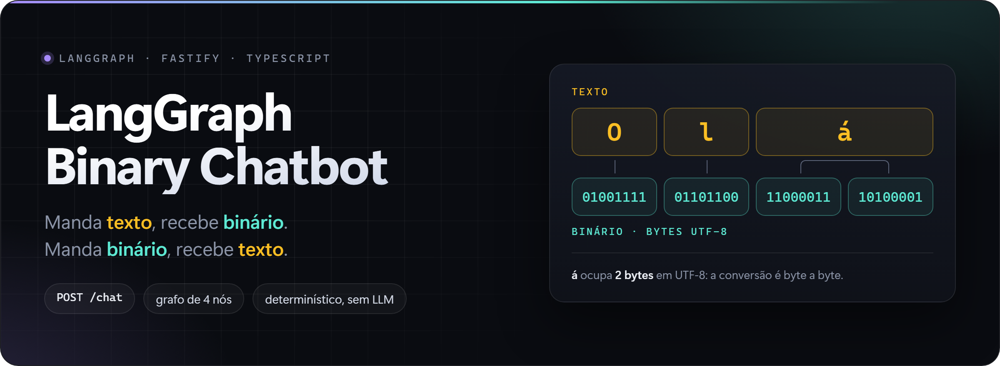
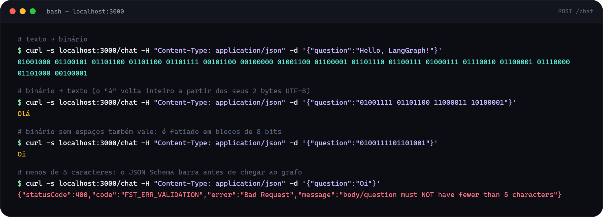
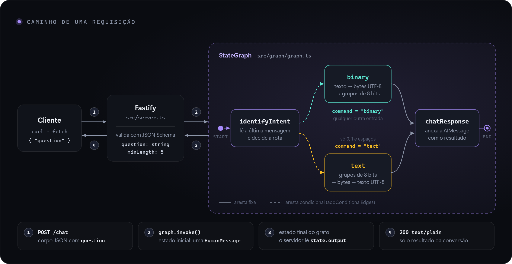
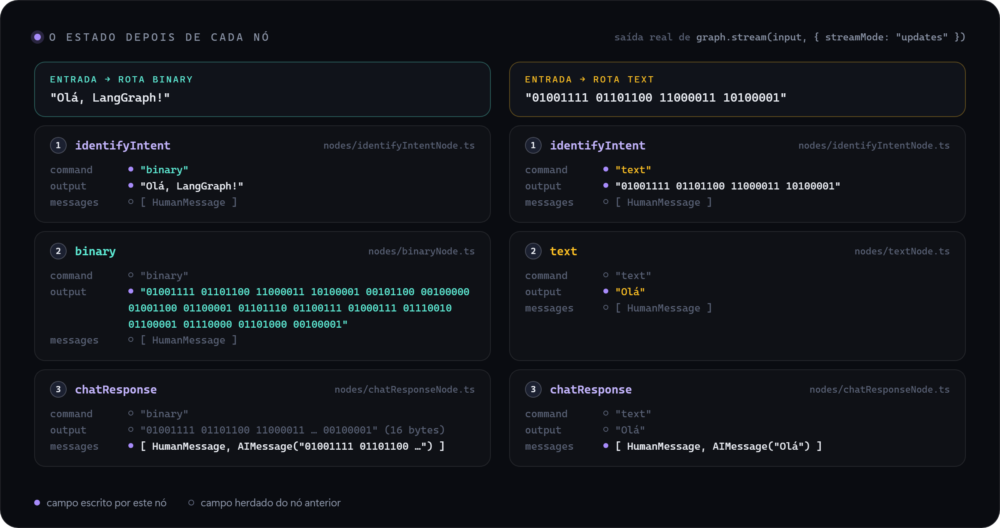
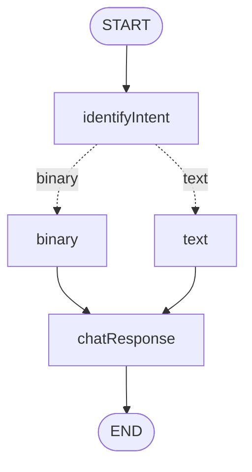
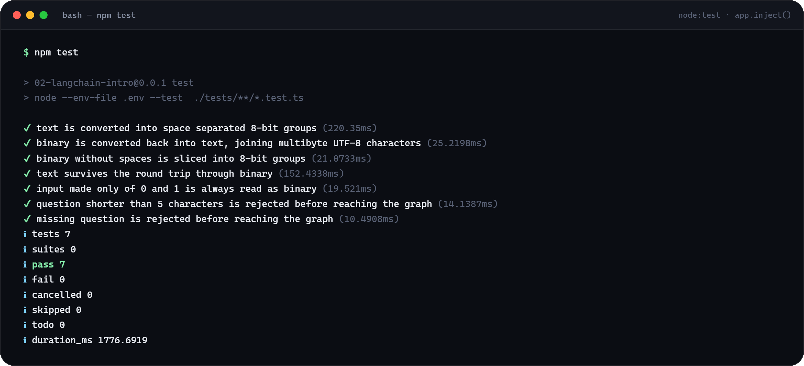

<div align="center">



# LangGraph Binary Chatbot

**Manda texto, recebe binário. Manda binário, recebe texto. Quem decide o caminho é um grafo.**


[Demo](#demo) · [Rodando local](#rodando-local) · [API](#api) · [Como funciona](#como-funciona) · [Testes](#testes) · [Limites](#limites-conhecidos)

</div>

---

Quase todo exemplo de LangGraph começa com um LLM no meio, e aí fica difícil separar o que é o
grafo trabalhando do que é o modelo "dando um jeito". Aqui não há modelo nenhum: o roteamento é
uma regex e cada nó é uma função pura.

Sobra só o que interessa entender — **estado, nós e arestas condicionais** — com saída sempre
igual para a mesma entrada, sem chave de API e testável com um `curl`.

## Demo

<div align="center">
  
</div>

<sub>Saída real do servidor rodando em `localhost:3000`.</sub>

## O que ele faz

- **Detecta o formato sozinho** — você não escreve "converta para binário". O grafo olha a
  mensagem e escolhe a rota, então um único endpoint serve para os dois sentidos.
- **UTF-8 de verdade** — a conversão é byte a byte, não caractere a caractere. `á` vira
  `11000011 10100001` e volta inteiro; `ação`, `café ☕` e `🚀 ok` fazem ida e volta sem perder nada.
- **Binário com ou sem espaços** — `01001111 01101001` e `0100111101101001` devolvem o mesmo `Oi`.
- **Entrada inválida não chega ao grafo** — o JSON Schema do Fastify responde `400` antes de
  qualquer nó rodar.
- **Nenhuma chave de LLM** — roda offline e de graça. O LangSmith é opcional e serve só para tracing.
- **7 testes e2e de ponta a ponta** — cada um atravessa validação, handler e grafo, e compara a
  resposta com igualdade exata.
- **TypeScript sem build** — o Node executa os `.ts` direto e `npm run dev` recarrega a cada save.

## Rodando local

Requer **Node 22.18 ou superior** (é a partir daí que o Node roda TypeScript sem flag). Testado no 24.21.

```bash
npm install
cp .env.example .env
npm run dev
```

O servidor sobe em `http://localhost:3000`. Em outro terminal:

```bash
curl -s localhost:3000/chat -H "Content-Type: application/json" -d '{"question":"Hello, LangGraph!"}'
```

```text
01001000 01100101 01101100 01101100 01101111 00101100 00100000 01001100 01100001 01101110 01100111 01000111 01110010 01100001 01110000 01101000 00100001
```

> [!NOTE]
> O `.env` é obrigatório porque os scripts usam `node --env-file .env`. O `.env.example` vem com
> o tracing do LangSmith ligado: com a chave de exemplo a API continua respondendo `200`, mas o
> terminal mostra um `403 Forbidden` do LangSmith a cada requisição. Coloque uma chave válida em
> `LANGSMITH_API_KEY` ou desligue com `LANGCHAIN_TRACING_V2=false`.

<details>
<summary>No PowerShell</summary>

No Windows PowerShell, `curl` é um apelido de `Invoke-WebRequest` e as aspas do JSON se comportam
diferente. Use:

```powershell
Invoke-RestMethod -Uri http://localhost:3000/chat -Method Post -ContentType 'application/json' -Body '{"question":"Hello, LangGraph!"}'
```

</details>

<details>
<summary>Texto com acento pelo terminal do Windows</summary>

No Git Bash, o `curl` não envia o argumento de `-d` em UTF-8, e uma pergunta como `Olá` chega
com o `Content-Length` errado (`400 FST_ERR_CTP_INVALID_CONTENT_LENGTH`). Grave o corpo em um
arquivo UTF-8 e envie com `--data-binary`:

```bash
printf '{"question":"Olá, LangGraph!"}' > pergunta.json
curl -s localhost:3000/chat -H "Content-Type: application/json" --data-binary @pergunta.json
```

</details>

## API

| Método | Rota | Corpo | Resposta |
|---|---|---|---|
| `POST` | `/chat` | `{ "question": string }` com 5 caracteres ou mais | `200 text/plain` com o resultado da conversão |

O que acontece com cada tipo de entrada:

| `question` | Rota no grafo | Resposta |
|---|---|---|
| `Hello` | `binary` | `01001000 01100101 01101100 01101100 01101111` |
| `01001111 01101100 11000011 10100001` | `text` | `Olá` |
| `0100111101101001` | `text` | `Oi` |
| `Oi` | não chega ao grafo | `400` · `FST_ERR_VALIDATION` · menos de 5 caracteres |
| *(campo ausente)* | não chega ao grafo | `400` · `FST_ERR_VALIDATION` · `question` é obrigatório |
| *(sem `Content-Type: application/json`)* | não chega ao grafo | `415` |

## Como funciona

<div align="center">
  
</div>

O Fastify valida o corpo, embrulha a pergunta em uma `HumanMessage` e chama `graph.invoke()`.
O grafo roda até o `END` e o servidor devolve apenas o campo `output` do estado final.

### O estado

Todos os nós leem e escrevem o mesmo objeto, declarado com Zod em
[src/graph/graph.ts](src/graph/graph.ts):

```ts
const GraphState = z.object({
    messages: withLangGraph(
        z.custom<BaseMessage[]>(),
        MessagesZodMeta
    ),
    output: z.string(),
    command: z.enum(['binary', 'text']),
})
```

| Campo | Papel |
|---|---|
| `messages` | Histórico da conversa. `MessagesZodMeta` liga o reducer de mensagens do LangGraph, que faz merge por `id`: os nós devolvem `...state` inteiro e mesmo assim nada duplica. |
| `command` | A conversão a aplicar. É o campo que a aresta condicional lê. |
| `output` | Área de trabalho: começa como a entrada crua e termina como o resultado. |

### Os nós

**1. `identifyIntent`** — [identifyIntentNode.ts](src/graph/nodes/identifyIntentNode.ts)

Pega o texto da última mensagem e testa uma única regex:

```ts
function isBinary(texto : string) : boolean {
    return /^[01]+(\s+[01]+)*$/.test(texto.trim());
}
```

Só `0`, `1` e espaços? Então a entrada já é binária e o comando é `text`. Qualquer outra coisa
recebe `binary`. Repare que `command` guarda a **conversão a fazer**, não o formato detectado.
O nó também copia a entrada para `output`, de onde o próximo nó vai ler.

**2a. `binary`** — [binaryNode.ts](src/graph/nodes/binaryNode.ts)

```ts
const binaryOutput = Array.from(Buffer.from(state.output, 'utf8'))
    .map(byte => byte.toString(2).padStart(8, '0'))
    .join(' ');
```

Texto → bytes UTF-8 → cada byte em base 2, completado com zeros à esquerda até 8 dígitos.
É o `padStart` que impede `!` (33) de sair como `100001` em vez de `00100001`.

**2b. `text`** — [textNode.ts](src/graph/nodes/textNode.ts)

```ts
const bytes = /\s/.test(input)
    ? input.split(/\s+/)
    : input.match(/.{1,8}/g) ?? []

const TextOutput = Buffer.from(
    bytes.map(byte => parseInt(byte, 2))
).toString('utf8');
```

Se há espaços, cada grupo é um byte. Se não há, a string é fatiada de 8 em 8. Os números voltam
para um `Buffer`, que é decodificado como UTF-8 — por isso `11000011 10100001` vira um `á` só, e
não dois caracteres estranhos.

**3. `chatResponse`** — [chatResponseNode.ts](src/graph/nodes/chatResponseNode.ts)

Ponto de encontro das duas rotas. Embrulha `output` em uma `AIMessage` e anexa ao histórico,
deixando o estado no formato de conversa que o LangGraph Studio e o LangSmith sabem exibir.

### O roteamento

A bifurcação é uma aresta condicional: uma função lê o estado e devolve a chave do próximo nó.

```ts
.addEdge(START, "identifyIntent")
.addConditionalEdges(
    "identifyIntent",
    (state: GraphState) => state.command,
    {
        binary: "binary",
        text: "text",
    }
)
.addEdge("binary", "chatResponse")
.addEdge("text", "chatResponse")
.addEdge("chatResponse", END)
```

Abaixo, o estado depois de cada nó nas duas rotas. Os valores vieram de uma execução real com
`graph.stream(input, { streamMode: "updates" })`:

<div align="center">
  
</div>

<details>
<summary>O mesmo grafo em Mermaid</summary>



Para gerar o diagrama a partir do código, em vez de desenhar à mão:

```ts
import { buildGraph } from './src/graph/graph.ts'

const graph = buildGraph()
console.log((await graph.getGraphAsync()).drawMermaid())
```

</details>

### Onde está cada conceito de LangGraph

| Conceito | No código |
|---|---|
| Estado tipado e validado | `GraphState` com Zod, em `graph.ts` |
| Reducer de mensagens | `withLangGraph(z.custom<BaseMessage[]>(), MessagesZodMeta)` |
| Nó como função `(state) => state` | os quatro arquivos de `src/graph/nodes/` |
| Aresta condicional | `addConditionalEdges("identifyIntent", state => state.command, {...})` |
| Fan-in | `binary` e `text` convergindo em `chatResponse` |
| Grafo exposto para ferramentas | `factory.ts` registrado em `langgraph.json` |

## LangGraph Studio

```bash
npm run langgraph:serve
```

O script chama o `@langchain/langgraph-cli` em modo `dev`, que lê o
[langgraph.json](langgraph.json) e carrega o grafo registrado como `agent`
(`./src/graph/factory.ts:graph`). Dá para ver o grafo desenhado, enviar mensagens e acompanhar o
estado passo a passo. O estado local desse servidor fica em `.langgraph_api/`, fora do Git.

## Estrutura

```text
.
├── src/
│   ├── index.ts                    # sobe o servidor na porta 3000
│   ├── server.ts                   # Fastify, JSON Schema e a rota POST /chat
│   └── graph/
│       ├── graph.ts                # estado, nós e arestas: o grafo inteiro
│       ├── factory.ts              # ponto de entrada para o LangGraph Studio
│       └── nodes/
│           ├── identifyIntentNode.ts
│           ├── binaryNode.ts
│           ├── textNode.ts
│           └── chatResponseNode.ts
├── tests/
│   └── router.e2e.test.ts          # 7 testes e2e com node:test e app.inject()
├── docs/                           # imagens deste README
├── langgraph.json                  # registro do grafo para o LangGraph CLI
└── .env.example
```

## Stack

**Grafo** LangGraph 1.4 · LangChain 1.5 (mensagens) · Zod (schema do estado)<br>
**HTTP** Fastify 5 com validação por JSON Schema<br>
**Runtime** Node.js executando TypeScript nativamente, sem etapa de build<br>
**Testes** `node:test` + `app.inject()`, sem abrir porta<br>
**Observabilidade** LangSmith (opcional)

## Testes

```bash
npm test
```

<div align="center">
  
</div>

Como não há modelo no caminho, a mesma entrada produz sempre a mesma saída. Isso permite
comparar a resposta com **igualdade exata**, sem mock e sem tolerância a "resposta parecida".

### Como os testes chegam ao grafo

A suíte em [tests/router.e2e.test.ts](tests/router.e2e.test.ts) usa o `node:test`, que já vem com
o Node, e o `app.inject()` do Fastify:

```ts
const chat = (body: Record<string, unknown>) => {
    const app = createServer()
    return app.inject({
        method: 'POST',
        url: '/chat',
        body
    })
}
```

O `inject()` entrega uma requisição HTTP ao servidor dentro do próprio processo, sem abrir porta.
Cada teste percorre o caminho inteiro de uma chamada real: JSON Schema, handler, os nós do grafo
e a serialização da resposta. Se qualquer uma dessas camadas mudar de comportamento, um teste quebra.

### O que cada teste garante

| Teste | Entrada | O que precisa voltar |
|---|---|---|
| Texto → binário | `Hello, LangGraph!` | Os 17 grupos de 8 bits, com `Content-Type: text/plain` |
| Binário → texto | `01001111 01101100 11000011 10100001` | `Olá`: os 2 bytes do `á` viram um caractere só |
| Binário sem espaços | `0100111101101001` | `Oi`, com a string fatiada de 8 em 8 |
| Ida e volta | `LangGraph`, `ação e reação`, `café ☕`, `🚀 ready` | Cada frase vira binário bem formado e volta idêntica ao original |
| Só `0` e `1` | `10101` | O byte `0x15`: registra o [limite conhecido](#limites-conhecidos) da detecção |
| Curto demais | `Oi` | `400` com `FST_ERR_VALIDATION`, sem tocar no grafo |
| Sem `question` | `{}` | `400` com `FST_ERR_VALIDATION`, sem tocar no grafo |

O teste de ida e volta é o que mais protege: ele não depende de um valor escrito à mão e pega
qualquer assimetria entre os nós `binary` e `text`, inclusive em caracteres de 2, 3 e 4 bytes.

### Modo watch e tracing

```bash
npm run test:dev
```

Reexecuta a suíte a cada arquivo salvo e abre o inspector do Node para depuração.

> [!NOTE]
> Os scripts de teste também leem o `.env`. Com o tracing ligado, cada execução envia traces ao
> LangSmith. Para rodar sem isso, sobrescreva a variável na chamada, já que o valor do ambiente
> tem precedência sobre o do arquivo: `LANGCHAIN_TRACING_V2=false npm test`.

## Limites conhecidos

- **Texto feito só de `0` e `1` é sempre lido como binário.** `10101` não vira "10101 em
  binário": vira o byte `0x15`. A regex não tem como distinguir a intenção.
- **O mínimo de 5 caracteres vale para os dois sentidos.** Um byte em binário (8 dígitos) passa;
  `Oi` não.
- **Não há checagem de múltiplos de 8.** Com espaços, cada grupo é lido como vier (`1001111`
  ainda é `O`). Sem espaços, o último bloco pode ficar com menos de 8 bits.
- **Bytes que não formam UTF-8 válido viram `�`** (U+FFFD), sem erro.
- **Sem memória entre requisições.** O grafo é compilado sem checkpointer, então cada chamada
  começa com uma única mensagem.

## Licença

ISC, conforme declarado no `package.json`.

## Autor

**Rafael Andrade** · [GitHub](https://github.com/RafaelAndradeSiqueira)
